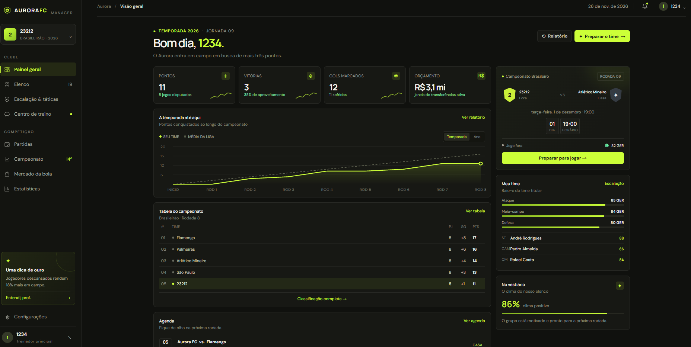

# Aurora FC Manager



Simulador de gerenciamento de futebol em português, feito para navegador. O projeto inclui cadastro e login, um clube persistido em SQLite para cada conta, gerenciamento do elenco, formação e estilo tático, treino, jogos simulados, calendário, classificação, mercado e estatísticas.

## Executar localmente

Requer Node.js 22.13 ou superior. O servidor usa o módulo SQLite integrado ao Node; não é necessário instalar um servidor de banco de dados separado.

```sh
npm install
npm start
```

Abra http://localhost:3000 e crie sua conta. Por padrão, o arquivo do banco é `data/aurora.sqlite`.

Para executar em produção, defina um segredo próprio para assinar sessões e configure o ambiente para `production`:

```sh
NODE_ENV=production JWT_SECRET="um-segredo-longo-e-aleatorio" npm start
```

Também é possível definir `PORT` e `DATABASE_PATH`. Use HTTPS em implantações públicas.

## API REST

`GET /api` lista as rotas; `GET /api/health` verifica o servidor. Cadastro (`POST /api/auth/register`) e login (`POST /api/auth/login`) retornam um token Bearer, usado nas rotas protegidas:

| Método | Rota | Ação |
| --- | --- | --- |
| `POST` | `/api/auth/register` | Cria conta, clube, elenco e temporada. |
| `POST` | `/api/auth/login` | Inicia sessão. |
| `POST` | `/api/auth/logout` | Revoga sessão. |
| `GET` | `/api/dashboard` | Carrega painel, atletas, temporada e classificação. |
| `GET` | `/api/players` | Consulta o elenco. |
| `PATCH` | `/api/players/:id/lineup` | Escala ou reserva um jogador. |
| `PATCH` | `/api/players/:id/training` | Define o treino, descansa e melhora os atletas. |
| `PATCH` | `/api/team/tactics` | Atualiza formação e estilo. |
| `PATCH` | `/api/team/profile` | Atualiza o nome do clube e do técnico. |
| `GET` | `/api/matches` | Lista o calendário e resultados. |
| `POST` | `/api/matches/:id/play` | Simula uma partida. |
| `GET` | `/api/tournaments` | Consulta campeonatos e classificação. |
| `GET` | `/api/transfers` | Consulta alvos e negociações. |
| `POST` | `/api/transfers` | Contrata um atleta disponível. |
| `GET` | `/api/stats` | Consulta os indicadores da temporada. |

As rotas protegidas aceitam `Authorization: Bearer <token>`. Senhas são derivadas com bcrypt e as sessões expiram depois de sete dias.
